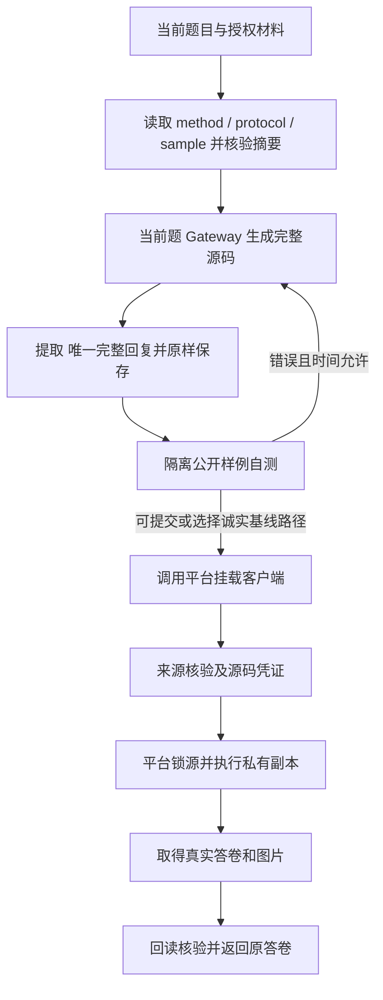

# 科研助手开发规范与 Agent 接力文档

> 文档版本：0.1 · 核对日期：2026-10-23（Asia/Shanghai）  
> 目标：为赛题一科研助手建立可追溯的需求、设计、开发顺序、验收标准和交接规则。  
> 当前阶段：需求与设计文档完成；业务代码、容器服务和正式评测尚未实现或验证。  
> 标记约定：**【要求】**来自官方材料；**【设计】**是本项目建议，尚待进入实现阶段时确认；**【待确认】**表示现有证据不足，不得自行当作平台保证。

## 1. 使用方法与交付目标

后续 Agent 先读根目录 [AGENTS.md](../AGENTS.md)，再读本文和 [开发进度与接力记录](开发进度与接力记录.md)，最后读取当前任务对应的官方原文。每次开发只推进一个可验收阶段，更新交接记录后结束；不能把“文档里计划存在”当成“代码已实现”。

【要求】最终交付一个科研助手 Agent 镜像，支持 Chat、Literature_Retrieval、Survey、Reproduction、Idea 五类任务，读取当前题授权的论文与实验材料，生成严格 JSON、实际 Markdown 和图表，并可由平台核验。论文事实、题目模拟观察、模型提出的假设、本轮实测结果必须明确区分。[S1][S3]

【设计】首个可交付版本以比赛容器服务为核心。PDF 批量解析、元数据提取、主题分类、语义理解检索、证据矩阵、科研分析和报告能力均在需求范围内；先通过模块/API 实现。网页 UI、账号系统、独立数据库、向量服务和通用多 Agent 调度平台暂不作为首版前置条件。后续如扩展交互产品，另立设计，不改比赛输出协议。

## 2. 阅读范围、实际目录与证据边界

### 2.1 当前工作区

```text
科研助手/
├── research-assistant/                 # Git 开发仓库；已有 AGENTS 初始化提交
│   ├── AGENTS.md                      # 后续 Agent 的简短入口
│   └── docs/                          # 本次新增的设计、接力记录、官方快照
├── 赛题信息/                           # 原始参考材料，只读保留
│   ├── research-description.md         # 本地旧版：objective-v2 / 25 题
│   ├── research-agent-spec.md
│   ├── research-scoring-rules.md
│   ├── FireShot Capture 050 - ...png   # 网页快照，已显示 v3 / 11 题
│   └── research-experiments-20261020-source-v1/
│       ├── D-01/、D-02/、D-05/
│       ├── 公开样例请求/                # 13 个完整 worker 请求
│       ├── model_source.py
│       └── run_experiment.py
└── agenthack-base-1.1.1.tar             # 官方基础镜像归档，不放进源码仓库
```

【已核对】本地三份总规范、网页截图、D 包全部共同说明、三个 method/protocol、样例和辅助代码已完成阅读与静态审阅；13 个公开请求已解析。D 包共 55 文件，54 个包清单条目和 27 个逐题哈希全部一致。重复 worker/artifacts/font 等通过内容一致性核验。

【已核对】另以公开只读 HTTP 请求取得当前赛题详情、比赛生效规则、三份新版下载规范和镜像包信息。当前线上 D ZIP 的 55 个文件与本地 D 包逐字节一致。基础镜像归档 SHA-256 与官方公布值一致；只读取了归档元数据，没有加载或启动容器。

官方快照保存在 [references/2026-10-23](references/2026-10-23/README.md)，URL、字节数和 SHA-256 见 [source-manifest.json](references/2026-10-23/source-manifest.json)。原始 `赛题信息/` 未被覆盖。旧文档内部失效链接也保持原样，避免改写官方材料。

**“读完所有现有赛题要求”不等于“已拿到全部正式题目”。** 当前没有正式派题、允许论文库、真实 Gateway 会话、私有测试或平台签名证据。未执行算法、未完成镜像接入、未取得正式成绩。不得将这些项目写成已验证。

### 2.2 版本优先级与冲突处理

先核对本轮任务与挂载协议的版本；字段合同查当前输入输出规范，评分查当前生效规则中的适用修订，D 算法查同轮 method/protocol 与来源指南。专用条款只能覆盖其声明的范围。出现无法消解的冲突，记录具体文件、版本与字段，等待平台澄清，不能凭发布日期把所有旧内容整体作废。

| 主题 | 过时或冲突内容 | 本次采用的开发基线 |
|---|---|---|
| 题数 | 本地三份文档：25 题、各类 5 题 | 在线 v3：11 题，A/B/C/D/E=1/3/2/3/2；按版本校验派题，不自行补题 |
| 派题结构 | `schema_version=2`、整数 `cases_per_category=5` | `schema_version=3`；`cases_per_category` 是分类计数字典 |
| C/E 评分 | 二值覆盖公式、简单引用覆盖公式、旧加权八槽位 | 生效规则的 `ce-quality-v1` 分档与扣分；见第 5 节 |
| D 执行 | 完整 helper 代做算法、D-01 四函数/40 轮 | `layered-d-v3` 的 `run_experiment(request)`；D-01 为 100 轮 |
| D 来源 | 预置实现直接提交 | `d-model-source-v1`：当前题 Gateway 生成完整源码，原样保存 |
| D 得分 | 8 个等权点、12+8、底层分数乘 2 | 流水线 20；指标计算 6、效果 10、图表 4；可信失败可有部分分 |
| 模型配置 | 本地旧接入附录 `CHALLENGE_*`；新 D 示例 `PLATFORM_*` | 存在真实接入差异，见第 7.3 节；不能拼凑配置或擅用个人接口 |
| 镜像目录 | 基础镜像默认 `/app` | 当前赛题交付工作目录 `/output`；应用代码可保留 `/app` |
| 排名 | 旧文档描述完整初赛榜 | 当前公开详情仍称正式总分/排名等待复核与完整性规则冻结；不承诺已具备排名资格 |
| HTTP 服务骨架 | 基础镜像预装 `agenthack_sdk 1.1.1`；组委会要求镜像入口执行 `AgentRuntime(MyAgent()).run()` | **必须用官方运行时启动**，但**不能直接用**其通用 `/solve`：SDK 路由是 `TaskRequest{task_id,task_type,input:dict,constraints:{timeout_ms}}` → `TaskResponse{task_id,status,output,metadata}`，与赛题一八字段输入（`constraints` 是**字符串数组**）和「只输出该类型允许的顶层字段」直接冲突，请求会 422、响应会多出禁用键。做法见 `runtime/official_runtime.py`：保留官方 app、`/health`、lifespan 与 `Telemetry` 实例，只替换 `/solve` 路由并注入 `runtime.telemetry`（禁止二次构造 Telemetry）；开发环境无 SDK 时 `api.create_app` 作为降级入口，两条路径共用 `runtime/http_solve.py` |

注意：[S2] 同一文件保留历史 D 段落，必须继续读到末尾“当前D类协议：layered-d-v3”。不能取前面的 6/6/7 检查点、四函数或 12+8 描述覆盖末尾修订。`20261020-source-v1` 是材料版本，`layered-d-v3` 是算法版本，`d-model-source-v1` 是来源准入版本，三者不能混为一谈。

## 3. 当前正式题量与输入合同

### 3.1 题目集合

| 类别 | 当前数量 | 当前选题规则 | 单题满分 |
|---|---:|---|---:|
| A / Chat | 1 | 从配置的 A-01～A-05 中随机抽取；实际 ID 以派题为准 | 5 |
| B / Literature_Retrieval | 3 | B-01、B-02、B-03 | 15 |
| C / Survey | 2 | C-01、C-03 | 25 |
| D / Reproduction | 3 | D-01、D-02、D-05 | 40 |
| E / Idea | 2 | E-01、E-02 | 15 |

上表是当前政策配置，不是预置答案表。解析器不能假定所有题号只有两位后缀；当前规范允许 `A-100` 等编号。D-03/D-04 属于历史材料提及范围，不是本轮缺少的必做题。[S2][S3][S4]

### 3.2 单题输入

【要求】八字段：`case_id`、`function`、`title`、`input`、`materials`、`constraints`、`expected_output`、`output_schema_ref`。示例中前四项及后两项为字符串，材料与约束为字符串数组；无材料/约束使用空数组。没有参考答案、内部评分配置或内嵌完整输出 Schema。

【设计】分别校验身份、类型、材料范围和业务语义。`function` 与 `output_schema_ref` 不一致时不得猜测路由。模型只产内容，程序控制当前 `case_id` 和授权路径；模型返回的未知字段不能直接透传。输入的未识别扩展字段记录为协议差异，由明确版本策略决定处理，避免擅自声称官方禁止一切未来扩展。

### 3.3 dispatch 与 HTTP 单题模式

正式 v3 派题的已公开字段：[S3]“派题记录与文件定位”。

- `schema_version=3`，`rules_version=research-assistant-objective-v3`。
- `selection_mode=random_a_fixed_bcde`。
- `dispatch_policy_version=research-assistant-dispatch-v3`、`dispatch_policy_sha256`。
- `cases_per_category={"A":1,"B":3,"C":2,"D":3,"E":2}`。
- `difficulty_by_case={"D-01":"easy","D-02":"medium","D-05":"hard"}`；D 的 `cases` 条目还含 `difficulty`。
- `dispatch_id`、`team`、11 个不重复 `case_ids`；`cases` 一一对应，含 `case_id/function/title/question_file/question_sha256`。

【设计】挂载 dispatch 时，验证规则版本、队伍、配额、题号唯一性、文件所属目录、原始题目字节哈希及 HTTP 请求与题目内容一致性。`dispatch_policy_sha256` 是平台给出的策略摘要，不是 Agent 自造的签名或可从公开摘要反推出的秘密配置。

【2026-10-24 修订】上述校验在 **Agent 侧只作告警**：组委会清单说明平台自己校验 dispatch/assigned 与请求一致性，且 Single 模式只保证当前题文件可读。因此 Agent 只核对当前题的 assigned 文件（缺失/哈希不符/未列出均记 warning），`dispatch.json` 结构损坏也只降级为 `dispatch=None` 后继续解题。材料授权与结果路径的强制校验不受影响——放宽的只有派题元数据这一层提示性检查。

【要求】当前协议明确：外部平台若直接逐题传 JSON，是否挂载派题文件由其接入协议决定。`POST /solve` 只解当前题，不能在一次请求中遍历整轮 11 题；未挂载 dispatch 时不能伪造记录。旧 25/5 题模式只能作为明确标识的历史调试配置。[S3]

## 4. 输出、落盘与权限

### 4.1 五类结果

| 类型 | 唯一允许的顶层字段 | 必须满足的内容 |
|---|---|---|
| A | `case_id, answer, clarifying_question` | 后两项均为非空字符串；回答问题并提出一个最关键澄清问题 |
| B | `case_id, papers` | 数组元素仅 `filename, reason`；真实允许 PDF，按相关性排序，无相关项可 `[]` |
| C | `case_id, path, markdown` | 完整 Markdown 与文件一致，正文至少 800 字符，事实和引用有来源 |
| D | `case_id, status, metrics, figures` | 状态合法、恰好三项完整指标、只列实际图；详见第 6 节 |
| E | `case_id, path, markdown` | 完整 Markdown 与文件一致，正文至少 800 字符，覆盖研究方案与证据边界 |

JSON 为 UTF-8，直接返回对象，无自然语言前缀和代码围栏；不增加 `function`、`details`、`error`、`score`、Token 用量等顶层字段。E 不再使用旧版 `research_question/technical_route/metrics` 结构。数字必须为有限 JSON 数字或规则允许的 `null`，不能使用数字字符串、NaN、Infinity。[S3][D2]

### 4.2 路径映射

| 产物或材料 | 运行时位置 | 边界 |
|---|---|---|
| 论文 | `/data/papers/` 中当前题允许文件 | 只读；挂载路径须在接入阶段确认 |
| 题目/派题 | `/output/data/<team>/dispatch.json`、`assigned/` | 存在时只读，不能作为结果覆盖 |
| 结果 JSON | `/output/data/<team>/<case_id>.json` | 当前题结果，HTTP 返回相同 JSON 对象 |
| Survey | `/output/data/expert/<case_id>-综述-<team>.md` | 文件名中间固定“综述”，不加主题名 |
| Idea | `/output/data/expert/<case_id>-灵感Idea报告-<team>.md` | 本项目选用该合法固定形式；官方允许更宽的 Idea报告 命名模式 |
| D 图片 | `/output/data/figure/<team>/...` | JSON 路径为 `data/figure/<team>/...` |
| 工作文件 | `/output/data/<team>/work/<case_id>/...` | 日志、缓存、证据索引、当前生成源码；不放在结果根冒充题目 |
| 正式 D 材料 | `/data/experiments/<case_id>/` 及根客户端 | 平台只提供当前授权材料，不能假定其他题目录存在 |

JSON 内的 `path` 相对 `/output`；执行 helper 的源码路径则按 CLI 要求传绝对路径，二者不可混淆。队伍名优先使用经确认的运行时稳定标识 `RESEARCH_WORKSPACE_TEAM`，与存在的 dispatch.team 核对，不能用展示队名自行替代。[S1][S3][L1][D3]

【设计】路径管理集中实现：拒绝绝对提交路径、`..`、反斜杠绕过及越界符号链接；解析真实路径后确认归属。共享 `data/expert` 只操作本队规范命名文件。保留中文、空格、`+` 等合法字符，禁止简单拼 shell 命令执行文件名。PDF 内容及任务材料作为数据读取，不能指挥程序读取其他队伍或内部评分目录。

【设计】C/E 先生成唯一正文字符串，UTF-8 原样落盘再回读比对；不得写文件后又让模型改 JSON 正文。通用结果用临时文件与原子替换，回读校验成功才报告完成。D 优先保留 helper 已保存的真实结果与图片，后续解析失败不能用占位失败结果覆盖它。

## 5. A/B/C/E 功能与当前评分要求

### 5.1 论文材料与证据层

【要求】支持 PDF 批量读取，提取标题、作者、摘要、关键词、年份、引用信息和正文，维护主题/方法/任务/数据集标签、解析状态和异常。扫描件在资源允许时 OCR；缺失、加密、重名、不可解析必须留下可见原因。按正文证据检索和分析，不凭文件名猜测内容。[S4][S5]

【设计】为每份允许论文记录：原始文件名、内容哈希、页索引、印刷页码（能核验时）、提取方法、原文片段、解析状态。事实记录额外标记 `paper_claim / task_observation / proposed_hypothesis / measured_result`。缓存键包含文件哈希、解析版本和当前授权范围；不得跨题泄漏证据，也不得缓存 D 的生成源码作下一题正式实现。

优先离线词项检索召回，再由赛事 Gateway 基于原文做语义重排和理由生成。是否使用 embedding 取决于平台是否提供合法接口与模型，不假设可以调用外部 embedding 服务。正文缺证据时缩小结论，不用推测补数。

### 5.2 A：科研对话

直接回答当前研究问题，明确变量、可能关系和证据限制；提出一个最有价值的范围限定问题。官方自动项为 `answer` 3 分、`clarifying_question` 2 分，但内容仍必须符合题意，不能用无关非空字符串应付。[S3][S5]

### 5.3 B：文献检索

从授权材料中找相关论文，按任务主题与排除条件筛选、去重、排序，每篇说明正文支持的具体相关性。没有相关文献返回空数组，不能凑固定篇数。

当前公式仍为 `max(0, min(15, 15H/N - 0.75U))`：H 为命中相关文献数，N 为冻结相关总数，U 为未命中集合的返回文献数。仅字母大小写不同按同篇评分和去重，其他字符必须一致；实际读文件与输出采用论文库原始名称。冻结集合不提供给 Agent，开发只能验证流程和自建样例，不能声称本地算出了官方 B 分。[S3][S5]

### 5.4 C：综述与引文

【要求】比较研究问题、方法、数据、指标、结论、局限和适用边界，形成技术脉络。正文至少 800 字符；按具体题目更高要求执行。正文用数字引用，末尾含 `## 参考文献`，至少 5 篇实际引用的指定论文及完整 PDF 文件名；材料不足时记录问题，不捏造第 5 篇。页码可用但必须有证据。

当前 `ce-quality-v1`：[S2]“赛题一”。

- **事实 15 分**：冻结事实逐项为 0、0.6、1 档；15 × 平均档位，替代旧二值事实公式。
- **引文 10 分独立计分**：合法性及正文/参考条目一致性 3、指定材料覆盖 3、反打包 1、跨段落均衡 1、上下文与材料 Metadata 主题相关 2。
- 无有效正文引用，引用分为 0。未知材料每篇扣合法性 1.5，僵尸/悬空/重复编号每处扣 1，合法性最低 0。仅列在参考文献不等于正文引用。
- 覆盖项为 3 × 实际正文引用的不同允许材料数占比。每组至少 3 个引用视为打包；打包占比 0 得 1，不超过 30% 得 0.5，否则 0。
- 每篇被引材料至少出现在两个实质段落，且单篇实例占比不超过 80%，均衡项得 1，否则 0.3。实质上下文最低 12 有效字符。
- 上下文相关性取 0/0.5/1，所有实例平均后乘 2，未知来源为 0；页码不影响自动分。**Metadata 主题相关不证明 PDF 原文支持，项目仍要求逐条核验事实。**

【设计】报告生成前建比较矩阵；生成后检查事实归因、引用编号、正文与文末映射、文件存在及来源覆盖。引用应服务于具体陈述，不能为了分布指标重复无意义内容。

### 5.5 E：研究方案

【要求】至少 800 字符，清晰分节：研究问题与边界、动机与已有局限、核心机制、技术路线、基线与改进组、数据集、实验与消融、量化指标、多文献互补、可行性与成本、失败边界和可证伪条件；末尾列真实指定论文。明确“模拟观察尚未验证”“所提改进尚未执行”。[S3]

当前评分为 15 × 八要点平均档位 × 专属性系数，再减扣分：八项分别是研究动机、技术路线、实验设计、基准数据集、量化指标、复现瓶颈反思、多文献互补、场景可行性；各项等权，档位 0/0.3/0.7/1。系数 high=1、medium=0.85、generic_template=0.55。缺明确基线/改进比较、缺具体量化指标、技术内容不足 200 字符，各扣 1，最多扣 3，最低 0；参考文献、代码和重复句不凑技术篇幅。[S2]

【设计】证据支持已有工作，实验设计支持待验证机制。模型评审只在预算允许时做一轮有针对性的检查，不把多轮自评当作真实实验。自动校验模板化句子和缺失比较组只能发现问题，不能取代官方档位判断。

### 5.6 汇总、异常与评分职责

当前自动总分为五类均值之和，分母分别固定为本轮政策的 1/3/2/3/2，不以完成题数缩小分母。类别上限为 5/15/25/40/15，总计 100，不再乘各类别百分比一次。D 的可信部分分按第 6 节保留。

区分选手失败、尚未完成和裁判/平台异常：C/E 裁判格式异常保留 `null`、待补评，不能冒充选手 0 分；D 无可信回执可能为 `evidence_pending`。这些是平台状态，不能加到答案顶层。评分原始数据、专家权重和用量记录由平台负责，Agent 不实现或提交自己的“官方裁判”。

Token 不计入自动分。旧规范的最终 70% 自动+30%复核框架仍有内部权重未确认；当前详情还保留正式排名关闭说明，因此只记录真实平台反馈，不自称正式排名或最终综合成绩。[S1][S2][S5]

## 6. D 类生成、执行与算法合同

### 6.1 三个输入/输出层次

| 层次 | 输入 | 输出 |
|---|---|---|
| 外层 Agent `/solve` | 八字段科研任务 | 最终 `case_id/status/metrics/figures` |
| 公共 worker | 恰好 `stage/payload` | 内部预测、排名或轨迹 JSON |
| 算法函数 | `payload`，含 `case_id/phase/data/protocol` | 当前题协议的原始算法结果 |

`sample.json` 是 `{case_id,phase,data}`，不是完整 worker 请求；自测使用 `公开样例请求/` 中含协议的完整文件。worker 负责调用与序列化，不建立沙箱，不验证全部算法正确性，不签可信回执。[D2][D3][D7]

### 6.2 生成与正式执行流程



【要求】每道 D 题在本轮本题 `/solve` 内使用赛事 Gateway 生成自包含源码：`stream=False`、完整回复 `finish_reason=stop`、UTF-8、1～65536 字节，顶层 `run_experiment(request)`，Python 3.9 标准库兼容。只允许 CRLF/LF 与末尾换行归一，不补 import、不加注释、不格式化、不应用 diff、不拼多个回复。截断或错误时让同一会话模型重新返回完整版本。[D1][D4]

提取工具接收完整 Chat Completions 响应，不是单独 `message.content`。其 AST 检查只确认 Python 3.9 可解析和入口函数名，并未检查完整签名、标准库限制或语义正确性。提取成功、语法通过、公开样例通过、平台来源准入、正式算法得分是五个不同事实。

正式调用使用当前平台挂载客户端：

```sh
python /data/experiments/run_experiment.py \
  --case D-05 \
  --implementation /output/data/<team>/work/D-05/implementation.py
```

上面 `<team>` 是说明占位，执行时须替换为平台稳定标识。helper 内部申请 `/source` 凭证，再向 `/run` 请求执行；Agent 不自制凭证、不绕过客户端、不调用管理员接口。禁止预置完整算法后让模型原样复述规避来源要求。

**CLI stdout 已是最终 submission 对象**；不能再盲目取 `result["submission"]`。RPC 外层 `complete`、答卷 `completed/failed/materials_missing`、判题 `valid/evidence_pending` 含义不同。helper 返回失败实验也可能已经成功保存真实部分结果。

锁源前可请求完整修复；锁源后只能以同源码、同题会话、剩余预算恢复既有结果，不启动新实验。状态不明、会话过期或平台证据异常时停止盲重试，保存错误与摘要。

### 6.3 D-01：TF-IDF 与 softmax 分类

来源：[D01M][D01P]。

- 分词：lowercase + `[a-z0-9]+`；词表和 IDF 只拟合当前条件训练集，词表/类别按字典序。
- `IDF=1+ln((1+N)/(1+df))`；raw TF × IDF 后 L2 归一，再追加 bias=1。未知词忽略，空文本保留 bias。
- softmax 线性分类器全零初始化，平均交叉熵加 L2；bias 也正则化。全批量更新 `W -= lr*(数据梯度和/N + penalty*W)`。
- 参数：100 轮、学习率 0.8、penalty 0.001。多数类基线和预测并列均取字典序最小类。
- 返回与 `data.texts` 顺序一致的 `baseline/candidate` 标签；候选存在时 `details` 直接含 `classes/vocabulary/idf/weights`，不能多嵌 `model`。权重为“类别数 × (词表大小+1)”，最后一列 bias，必须能重建预测。
- 独立处理每个条件；最终指标按各主条件算术平均，不能混池重算。权重不要求逐元素等于参考，但方法及实际模型来源必须正确。

最终指标顺序：`Macro-F1 / 分数`、`Accuracy / %`、`运行时间 / 秒`。运行时间由可信框架测整个主阶段墙钟时间，含启动与 I/O，不能上报自计训练耗时替代。

### 6.4 D-02：标题/正文 BM25 与稳健选参

来源：[D02M][D02P]。

- 标题、正文分别建立 BM25 统计，lowercase + `[a-z0-9]+`；N 含空字段文档，平均长度为 0 时按 1；重复查询词重复贡献。
- 每词分数：`ln(1+(N-df+0.5)/(df+0.5))*f*(k1+1)/(f+k1*(1-b+b*length/avg_length))`，f=0 贡献 0。
- 总分=正文分+`title_weight*标题分`，排序 `(-score,id)`，包含全部文档/测试查询。
- 基线：`k1=1.2,b=0.75,title_weight=0`。候选穷举 `k1={0.4,1.2,2}` × `b={0,0.5,1}` × `title_weight={0,0.5,2}`，共 27 组；默认基线不在候选网格内。
- 仅 dev 标签选参：最大化最差组 MRR，再组等权宏 MRR，再组等权宏 Recall@5；三项先四舍五入到 12 位；仍并列按 `title_weight,k1,b` 升序。普通查询均值只报告，不能代替组宏均值选参。
- run 返回测试 `baseline/candidate` 排名、`details.selected` 和含全部 27 行的 `details.search`。每行含 config、开发排名、普通 Recall/MRR、`group_metrics`（groups、worst_mrr_at_10、macro_mrr_at_10、macro_recall_at_5_percent）。
- rank 只用 `data.selected` 返回 `{candidate: rankings}`，不重新选参；正式 rank 采用 query_id 字典和 `{id,score}` 行，兼容公共 benchmark 的实际读取方式。

最终指标：`Recall@5 / %`、`MRR@10 / 分数`、`查询吞吐 / queries/s`。质量指标先语料内查询平均再主语料平均；吞吐在第一主语料独立 rank 批次测量，30 calls、3 repeats，含启动/I/O/排名哈希。`rank-default.json` 只测默认基线；候选一致性测试必须回填 run 的真实 selected。合成 qrels 不能描述为论文原始或人工标注。

### 6.5 D-05：FIFO 与加权公平调度

来源：[D05M][D05P][D3]。

- 任务含 `id/flow/arrival_ms/service_ms/deadline_ms`，非抢占；到达顺序 `(arrival_ms,id)`，空闲服务端按编号升序。
- 同一时刻依次：释放已完成服务端 → 纳入到达任务 → 丢弃 `deadline<=now` 的等待任务 → 派发。
- FIFO 取最早等待任务；公平策略取 `(累计已分配服务毫秒/flow_weight,arrival_ms,id)` 最小任务。**成功派发立即预留服务量**，不能等服务完成才累计。
- 同服务端换流付 setup，首次无 setup；空闲不清除上一流。选中后不因 setup 期间新到达而换任务。
- 先判断 `start>=deadline`，再判断 `end>horizon`；`end==horizon` 可完成。拒绝任务不回队、不改变上一流，当前空闲服务端继续尝试；成功后转下一服务端。
- 无可派任务推进到未来事件，不能使用旧 free_at 原地循环。每题每条件从空状态开始，每任务恰好进入 trace 或 dropped 一次。
- 返回 baseline FIFO、candidate fair 或诚实 null、details 对象。每个 run 含 `trace/served_ms/dropped`；trace 包含原字段和 `server/dispatch_ms/setup_ms/start_ms/end_ms/wait_ms`，按派发时刻/服务端排序；dropped 只含 id/reason，按 id 排序；served_ms 包括零服务流。

指标：`公平性 Jain 指数 / 分数`、`归一化吞吐 / %`、`平均等待时间 / ms`。Jain 使用完成服务量/流权重；吞吐为有效服务毫秒÷(servers×horizon)×100，不含 setup；等待只计完成任务。算法输出真实轨迹，指标由可信框架计算；零任务 Jain 的退化取值不得自行猜测写成官方指标。

三主场景等权：单服务端无开销、双服务端无开销、双服务端含突发/开销/截止/窗口。全部主候选可核验才输出总指标，否则 `failed` 且 observed 全 null，可保留可信部分图和部分分。边界允许 1～3 个虚拟服务端，不能硬编码永远两个。

### 6.6 统一评分、资源与错误分类

| D 分项 | 分值 |
|---|---:|
| 输入处理 / 基线 / 候选运行 / 可追溯产物 | 各 2，共 8 |
| 条件覆盖 / 独立复跑 / 边界 | 各 4，共 12 |
| 指标计算 / 实验效果 / 图表 | 6 / 10 / 4，共 20 |

效果项使用相对基线到参考实现的裁剪进度：D-01 看 Macro-F1；D-02 Recall/MRR 等权；D-05 公平性/吞吐/低等待权重 0.6/0.2/0.2。参考未优于基线时不虚构改善。最终每题 40 分，不再乘 2。`candidate=null` 本身不保证“保底 10 分”。[D5]

【要求】算法 Python 3.9 标准库、离线、非 root、单进程、1 CPU/1024 MiB、每阶段 20 秒；外层整题 180 秒包括模型生成、修复、自测、正式运行、落盘与返回。helper 的 600 秒通信上限不是新的整题时间额度。

【设计】使用 monotonic 截止时间贯穿调用链；每个模型、子进程和文件收尾阶段都领取剩余预算。修复次数和正式阶段预留时间先通过测量确定，禁止无界 SDK 重试、把多个 20 秒阶段误算成整个正式流程只需 20 秒。开发期 Docker 自测不意味着线上 Agent 可访问 Docker socket；线上隔离方式必须由平台许可确认，不能直接 exec 不受限模型源码。

| 错误 | 开发动作 |
|---|---|
| `D_SOURCE_NOT_GENERATED_THIS_SESSION` | 查当前会话、完整回复、源码摘要；不等同于“模型完全没调用” |
| `D_SOURCE_CREDENTIAL_REQUIRED/INVALID` | 查挂载客户端及会话，不复用其他题凭证 |
| `D_SOURCE_ALREADY_LOCKED` | 禁止换源码；仅在条件满足时恢复同源码结果 |
| `D_SOURCE_REQUEST_LIMIT` | 停止无效申请循环，记录错误 |
| `D_SOURCE_AUDIT_UNAVAILABLE`、可信执行 503 | 记录为平台审计/存证待核查，不能伪造分数 |
| 自测代码错误、截断或多份不同实现 | 在时间允许且未锁源时让模型返回完整修复版 |
| 正式结果已产生，外层解析出错 | 保留 stdout/stderr 和已落盘产物，先核对真实结果，禁止覆盖 |

完整诊断依据 [D6]。最终失败答卷仍有三项完整指标对象，保留 name/unit/reference/observed/relative_error；无真实图用 `[]`。公共 artifacts 打包器需要实际系列数据，不能用它制造零图片失败证据或可信签名。

## 7. 建议架构与配置边界

### 7.1 选型建议

| 方案 | 适用性与取舍 |
|---|---|
| **Python 单服务 + 显式任务处理器（推荐）** | 接近镜像环境，易复用 PDF/JSON 工具和 D helper，时间预算与数据流易解释 |
| Python 编排框架 / 多 Agent 自主协作 | 适合复杂探索，但增加状态、调用次数、超时和输出约束管理；确有收益再引入 |
| Go HTTP 服务 + Python 工作进程 | 可做后续工程扩展，但增加部署、IPC、取消传播与两套依赖；当前比赛版本收益不足 |

【设计】外层先考虑镜像已有 Python 3.11 系列，FastAPI/Pydantic 做 HTTP 与类型校验，HTTP 客户端适配赛事 Gateway，PDF 提取/OCR 由可替换适配器承担。上述第三方库尚未安装或锁定版本；进入实现时在基础镜像验证兼容性并锁定依赖。**外层 Python 与 D 的 Python 3.9 是两个环境。**

建议目录（以下均为拟建，不表示文件已存在）：

```text
src/research_assistant/
  api.py                 # /health、/solve，严格请求/响应边界
  contracts/             # task、dispatch、五类输出、内部证据类型
  runtime/               # settings、deadline、gateway、路径、落盘、日志
  documents/             # PDF/文本提取、OCR、索引、证据片段
  handlers/              # chat、retrieval、survey、idea、reproduction
  reproduction/          # 材料读取、生成源码、来源提取、自测、正式helper
  validation/            # schema、引用、文件一致性、材料授权验证
tests/
  unit/                  # 无网络、无平台依赖的规则与异常测试
  integration/           # 临时工作区、假Gateway、真实文件读写
  contract/              # 五类HTTP与dispatch、helper输出合同
  fixtures/              # 明确标识的自建测试材料；不含正式答案
scripts/                 # 将来添加的本地验证与构建入口
Dockerfile、pyproject.toml、依赖锁文件
```

### 7.2 模块交接接口（设计草案）

| 模块接口 | 消费 | 产出 / 不负责的事 |
|---|---|---|
| `solve(task, context)` | 校验后的 Task 与本次 SolveContext | 当前类型 Result；不遍历全轮，不生成官方评分 |
| `load_task_context(task, settings)` | 当前请求、可用 dispatch、运行时身份 | 授权材料、工作目录、deadline、版本信息；不猜测缺失题目 |
| `extract_documents(materials, context)` | 允许文件路径 | Document 列表、元数据/页片段/解析状态；不改原文件 |
| `build_evidence(task, documents, context)` | 题意与原文 | EvidenceItem 列表；不把模型推测记成原文 |
| `gateway.complete(messages, context)` | 当前会话、剩余预算 | 完整响应和可记录的 usage/finish_reason；不暴露凭据 |
| `reproduction.solve(task, context)` | D 当前材料与会话 | 平台 helper 的真实 Result；不手算官方 observed |
| `persist_and_verify(result, context)` | 已校验 Result | 原子落盘/回读结果；不重写已成功的 D 实验数据 |

进入具体阶段时，把草案落实成精确类型和测试；接口改动先更新文档及相关测试，再通知依赖模块。`SolveContext` 至少集中管理 case_id、稳定 team、允许材料、输出根、工作根、会话配置、截止时间和脱敏日志上下文；不使用可串题的模块级可变状态。

### 7.3 模型网关与运行时配置

当前 D 指南示例使用 `PLATFORM_LLM_URL / PLATFORM_API_KEY / PLATFORM_LLM_MODEL`；本地旧接入附录使用 `CHALLENGE_LLM_BASE_URL / CHALLENGE_LLM_API_KEY / CHALLENGE_LLM_MODEL / CHALLENGE_SESSION_ID` 和 `X-Session-ID`。线上新总规范删除了旧附录，基础镜像只含部分空占位变量，**不能证明实际会话注入方式**。[D4][L1]

【设计】配置适配器选择一个经联调确认的完整变量组；缺失或两组冲突时报配置错误，不逐变量混合 fallback。保留平台 URL 的完整路径及会话标识；按实际协议传会话头。不能裁剪为自猜 `/v1`、使用个人 API、跨题复用会话或把所有环境变量打印出来。模型名、上下文上限、Token 配额不得硬编码为臆测值。

【已实现·2026-10-23】`runtime/settings.py` 按上述规则实现：两组各自「必需变量全部非空」才算齐备；恰好一组齐备则用之；两组齐备且值相同用 `CHALLENGE`；两组齐备但值不同报 `ConfigError` 且**只列 differing 的字段名，不列值**；两组都不齐备则 `gateway=None` 并记 `gateway_config_error`。`from_env` 不因网关问题抛异常，以便 `/health` 保持 200（见第 7.4 节理由）；网关错误改由 `require_gateway()` 在解题时抛。预算 `RESEARCH_CASE_BUDGET_SECONDS` 必须是有限正数——`nan` 与任何值比较均为 False，只写 `> 0` 会让它漏过并使整层时间守卫静默失效。

【已核对·2026-10-23 开发网关实测】负责人提供的开发网关为 OpenAI 兼容 Chat Completions：`GET {base_url}/models` 正常列出模型；`POST {base_url}/chat/completions`、`stream=false` 返回标准 `choices[0].message.content`、`choices[0].finish_reason`、`usage.{prompt_tokens,completion_tokens,total_tokens}` 与 `usage.prompt_tokens_details.cached_tokens`；`usage.completion_tokens_details` 可为 `null`；`message` 含 `reasoning` 字段（推理型模型，实现不得假定其缺失）；`system_fingerprint` 为 `vllm-0.23.0-tp4-dp8-ep-…`。**不带 `X-Session-ID` 也返回 200。** 一次 A 类完整解题实测约 9.2 秒、429 tokens。凭据只存于被 gitignore 的 `.env.local`，不进代码、镜像、结果文件与提交的测试。

此实测**只回答开发网关**，不得外推为「平台一定不要求会话头」或「正式环境就是这套变量名」；Q01 仍未关闭。

D helper 的 `RESEARCH_EXPERIMENT_CASE/URL/TOKEN`、`RESEARCH_LAYERED_D`、`RESEARCH_D_SOURCE_PROVENANCE` 是平台注入合同，正式环境由挂载客户端消费；本地假服务必须标为测试，不能冒充来源证明。

### 7.4 部署与故障处理

【要求/已确认】以 `agenthack/base:1.1.1` 构建 Linux/AMD64 镜像，非 root，声明 8080/tcp，实现 GET `/health` 与 POST `/solve`，工作目录 `/output`，所需依赖构建时预装。基础镜像默认 CMD 故意退出 1，必须覆盖；归档声明有 curl 健康检查。代码可放 `/app`，通过包安装或显式模块路径保证换工作目录后可导入。[S1][S6]

【设计】健康检查只报告服务就绪，不触发付费模型请求或实验。异常分类为输入、材料、配置、模型、超时、算法、存储、平台证据问题；写脱敏日志，不扩展答案 Schema。B 的“无相关论文”与“解析失败”分开记录；A/C/E 失败不能返回伪装成功的空壳报告。

【已实现·2026-10-23】`/health` 只在**输出根不可写**时返回 503，队伍标识或网关未注入仍返回 200，改由 body 的 `team_configured`/`gateway_configured` 分量报告，且不触发任何模型请求。理由：healthcheck 失败会让整轮评测根本起不来，代价远大于单题报配置错误。响应体形如 `{"status","version","rules_version","workspace_writable","workspace_root","team_configured","gateway_configured","dispatch_mounted"}`，字段属 Q03【待确认】，联调时按平台要求调整。

`/solve` 的错误映射：`TaskContractError`/`DispatchValidationError`/`MaterialUnavailableError` 422、`PathAuthorizationError` 403、`ConfigError`/`PersistenceError` 500、`GatewayError` 502、`BudgetExhausted` 504、`HandlerNotImplemented` 501；错误体统一 `{"error":{"type","message","case_id"}}`，**只用于非 2xx**，不得混入答案 JSON。未预期异常只回类名不回消息。响应体直接复用落盘那份 bytes（FastAPI 默认 JSONResponse 会用不同分隔符重新序列化，做不到逐字节一致）。D 类的 `failed`/`materials_missing` 走 200 正常通道，不走错误通道。

【已核对·2026-10-23 基础镜像只读检查】对 `agenthack-base-1.1.1.tar` 做归档级只读检查（未 `docker load`、未启动容器），逐层解析 OCI blob 与 whiteout 后得到最终生效版本：Python 3.11.16、`fastapi 0.111.0`、`starlette 0.37.2`、`pydantic 2.8.0`/`pydantic-core 2.20.0`、`uvicorn 0.30.0`、`httpx 0.27.0`（层 6 装的 0.28.1 被层 7 装 `openai 1.35.0` 时降级并 whiteout）、`httpcore 1.0.9`、`anyio 4.15.1`、`requests 2.32.0`、`numpy 1.26.4`、`pandas 2.2.2`、`tiktoken 0.14.0`、`orjson 3.12.0`、`langchain 0.2.0`/`langchain-openai 0.1.8`、`agenthack_sdk 1.1.1`；`pytest`/`ruff` **不存在**（只能作本地 dev 依赖）。镜像默认 `USER agent`、`WORKDIR /app`、`EXPOSE 8080`、`HEALTHCHECK` 为 `curl -fsS http://localhost:8080/health`（Interval 5s/Timeout 3s/StartPeriod 10s/Retries 6），默认 CMD 打印错误并 `exit 1`。

**镜像中缺失且必须自行解决的能力**：任何 PDF 解析库（无 pypdf/pdfminer.six/PyMuPDF）、无 Pillow、无 matplotlib、无 OCR（pytesseract/tesseract）、无 scikit-learn。D 类图表由平台侧冻结实验容器生成，因此缺 matplotlib 不构成 D 类阻塞（待在 P4 用真实 helper 复核）；但 **B/C/E 读论文需要 PDF 解析，这是 P2 的前置阻塞项**，见第 12 节 N01。

【待确认】`/health` 的响应体、A/B/C/E 异常 HTTP 状态、重复请求/并发行为、真实挂载与 UID 权限、线上可用自测隔离机制。建议本地默认一题一上下文，但不能声称平台已承诺跨请求共享缓存。所有类型先按严格预算设计；D 的 180 秒已有新版材料依据，其他类别精确超时需接入联调确认。

## 8. 开发规范

1. Python 新代码四空格、类型注解、snake_case 函数/变量、PascalCase 类型；模块围绕单一职责组织，避免一个 handler 同时负责路径、模型、评分和文件写入。
2. 规范与阶段任务使用中文，代码标识使用英文；schema 键、指标名称、单位、题号不可翻译或归一化改写。精确依赖与格式工具拟用锁文件、Ruff、pytest，当前尚未配置。
3. 官方目录与快照只读；业务源码、测试材料、临时模型源码和运行结果分开。格式化器必须排除官方材料和需保持原样的模型生成源码。
4. 凭据仅运行时注入。只记录错误类型、耗时、源码/材料摘要、finish_reason、版本与必要关联 ID；不记录请求头、API key 或全量环境。
5. 先写能暴露问题的合同/异常测试，再实现关键行为；不能写只重复实现细节的测试。文档改动检查链接、语义和版本，不为文字修改构造无意义业务测试。
6. 当前初始提交为 `7560db4 feat:add AGENT.md`；后续建议 `docs:`、`feat:`、`fix:`、`test:`、`chore:` 加简洁祈使说明。单条历史不代表完整团队惯例。PR 写明需求 ID、影响模块、验证命令/结果和未解决限制；图表/输出改变附实际样例。
7. 不覆盖他人未提交改动，不自动重置分支或改官方材料。实现结束时必须区分“本地已实现”“测试已通过”“镜像已验证”“平台已验证”。

## 9. 验收矩阵与证据分级

以下是**待实现验收要求**，不是本次已通过的测试清单。

| ID | 验收范围 | 最低可复现证据 |
|---|---|---|
| G01 | v3 dispatch | 11 唯一 ID、字典配额、策略/题目哈希核验；错误team、重复ID、缺题、错哈希被拒 |
| G02 | 单题 HTTP | 五类输入正确路由；当前 ID 原样返回；不在单次请求处理全轮；不输出围栏或额外键 |
| G03 | 授权路径 | 中文/空格/+ 正常；绝对提交路径、`..`、符号链接越界、他队报告被拒 |
| G04 | 文档解析 | PDF/文本/Markdown/JSON及扫描件路径；正文/页号/元数据；缺失和解析失败可见 |
| G05 | 落盘一致性 | JSON 可回读、HTTP对象一致；C/E逐字一致；图存在；权限失败不报告成功 |
| A01 | Chat | 回答和一个关键追问均非空、与问题相关 |
| B01 | Retrieval | 原始文件名存在/允许、大小写等价去重、排除条件、正文理由；空集合合法 |
| C01 | Survey | 长度、比较维度、真实事实、至少5篇指定来源、数字引用与参考映射 |
| C02 | 引文质量 | 悬空/重复编号、未知材料、无正文引用、打包/跨段落分布等可诊断；不伪造官方档位 |
| E01 | Idea | 八要点、证据分类、基线/改进组、消融/量化指标、有效技术篇幅、失败及证伪 |
| D01 | 源码提取 | 纯源码/代码块、CRLF、stop；拒截断、缺入口、多版本；保存摘要匹配 |
| D02 | 生成流程 | 自测失败只经模型完整修复；不本地补码；锁源后不换源；旧/跨题凭证不复用 |
| D03 | 算法公开请求 | D-01三项、D-02三项、D-05七项共13请求；另核对候选run/rank一致 |
| D04 | 算法不变量 | D-01训练泄漏/模型重建；D-02全网格/组宏均值/稳定排序；D-05任务守恒/预留/事件顺序 |
| D05 | helper合同 | stdout为最终答卷；failed可携真实图；三指标完整null；已有成功产物不被错误路径覆盖 |
| R01 | 截止与取消 | 模型慢/超时、子进程挂起、重试限额、剩余预算不足；取消传播且保留已完成产物 |
| R02 | 镜像交付 | linux/amd64、非root、/output可写、8080与health/solve可达、离线依赖齐全 |
| R03 | 平台联调 | 真实会话生成/来源准入、可信执行/图表、当前题返回、整轮有效状态与评测ID |

测试数据优先自建最小反例与公开样例；无私有金标时检查方法和不变量，不能把推测输出写成官方答案。D 生成代码只在开发期明确隔离容器或获平台授权的执行器中运行，不能在开发宿主直接 `exec`。

证据分四级：**静态核对**（文件/哈希/接口）→ **本地测试**（独立样例）→ **镜像测试**（目标架构与真实服务）→ **平台验证**（当前会话与评测证据）。每次报告注明级别、命令、时间、版本、输出位置；高级结论不能由低级检查替代。

## 10. 分阶段开发顺序

下面是开发路线与完成门槛。具体代码任务在进入该阶段时，依 Superpowers 设计/计划流程细化，不代表本轮已授权执行所有代码阶段。

| 阶段 | 工作与拟建模块 | 完成门槛 | 依赖 |
|---|---|---|---|
| P0 需求基线 | 本文、来源快照、接力记录、AGENTS | 规则冲突明确；材料摘要一致；可追溯到原文 | 本次完成 |
| P1 最小合规服务 | api/contracts/runtime、路径、落盘、deadline、假Gateway | G01–G03/G05/A01/R01的本地合同测试；目标镜像health与A端到端；真实Gateway配置仍单列 | P0设计确认 |
| P2 文档与检索 | documents、证据索引、B handler、OCR适配 | G04/B01；授权小论文集可回读、定位、排序和解释 | P1 |
| P3 综述与Idea | C/E handlers、引用校验、报告持久化 | C01/C02/E01；同一组允许材料出合规可追溯报告 | P2 |
| P4 D编排与D-01 | source/generator/正式helper适配、D-01提示与自测 | D01/D02/D05；D-01公开边界和模型重建；来源准入另经平台验证 | P1；可与P2/P3按接口分工 |
| P5 D-02与D-05 | 两题生成策略、方法检查、边界与预算调优 | D03/D04；27组选择/rank一致；三档调度和任务守恒 | P4 |
| P6 发布与联调 | 可复现构建、依赖清单、端到端数据、平台证据 | R02/R03；11题完整性、无越界/伪造、结果与真实产物一致 | P1–P5 |

P1 先消除协议、路径和交付问题；P4 的来源准入尽早联调，避免所有算法工作完成后才发现网关不匹配。C 与 D 合计占自动分 65，但功能覆盖不能省略其他类别。每阶段只在门槛达成后标记完成，不用“基本完成”掩盖缺失平台验证。

## 11. Agent 接力规则

1. **开始前**：确认 cwd 是 `research-assistant/`；读取 AGENTS、本文、进度记录；执行 `git status --short`，检查已有改动和最近记录。
2. **认领范围**：在进度记录写阶段/任务、需求 ID、负责人、允许修改文件、依赖接口与不包含内容。并行 Agent 分离写入范围；共享合同先统一后分工。
3. **实现期间**：重大方案变化记录原因与影响；新官方规则保存新日期快照，并更新冲突表，不能静默覆盖旧来源。发现与当前阶段有关的未决项再澄清，不因无关未决项停止所有工作。
4. **结束前**：验证当前改动，记录真实命令、返回结果与产物路径；明确未执行的检查。更新阶段状态及下一步，避免下一个 Agent 重读所有历史或重复工作。
5. **交接内容**：目标、当前事实、改动文件/函数、关键决定、测试证据、未决项、失败尝试、下一条可执行动作。未提交改动也须记录，不要求为了交接擅自提交或推送。
6. **完成定义**：需求可追溯、接口与实现一致、相关测试通过、文档同步、已知限制写明。平台验证未完成只能标“本地通过/待联调”，不能标“比赛完成”。

统一交接模板和当前状态见 [开发进度与接力记录](开发进度与接力记录.md)。

## 12. 待确认问题与推进策略

| ID | 未决项 | 何时必须确认 | 当前可继续的工作 |
|---|---|---|---|
| Q01 | 实际模型变量族、会话URL/请求头、模型名、Token/上下文限额。**2026-10-23 部分关闭**：开发网关实测为 OpenAI 兼容 vLLM、`stream=false` 返回标准 usage、不需要 `X-Session-ID`（见第 7.3 节）。正式环境的注入变量名、会话头要求与模型名仍未确认，不得外推 | 首次真实平台 Gateway 请求前 | 已完成：整组探测适配器 + 真实网关 A 类端到端（`uv run pytest -m live`） |
| Q02 | 外部平台是否挂载dispatch，实际论文路径、稳定team与输出UID权限 | 镜像接入前 | 分离单题/dispatch模式；临时目录集成测试 |
| Q03 | health体、非D失败HTTP合同、重试/并发及精确限时 | P1接口冻结/联调 | 类型、路径和正常响应测试；错误分类日志 |
| Q04 | 正式论文、A/B/C/E任务与完整机器Schema、dispatch示例附件 | 真实任务验收前 | 自建带标签的开发fixture，不能当正式题 |
| Q05 | 线上是否允许额外隔离自测，D正式全部阶段耗时。**部分关闭**：自测已改为受限子进程（`-I` 隔离、无 shell、RLIMIT_CPU/AS/NPROC、墙钟超时、cwd 锁定本队 work 目录），不需要 Docker socket；但若平台禁止在 Agent 容器内执行模型源码，这一层必须去掉并接受锁源后无法修复的风险。实测生成耗时 D-01 42.7s / D-02 85.6s / D-05 94.4s | D预算策略定稿前 | 已实现自测与预算预留（55s 正式运行 + 12s 自测 + 5s 落盘） |
| Q06 | 专家/Token折算、同分/latest-best、截止与上传/申诉限额、正式排名启用 | 发布/解读成绩前 | 完成功能与自动项质量，保留版本和评测证据 |
| Q07 | 赛题详情 `timeslice_budget=300` 的单位与作用 | 使用该值分配预算前 | 不解释成300秒或Token额度；D按180秒新版要求 |
| N01 | **已关闭（2026-10-24）**：选 `pypdf==6.21.2`——纯 Python、零强制依赖（crypto/image/full 全是 extras），不需要平台专属 wheel，从 macOS/arm64 构建 linux/amd64 结果一致；已在隔离环境实测能正确提取正文并进入镜像。排除 `pdfminer.six`（需 `cryptography>=36`，C 扩展）与 `PyMuPDF 2.0`（AGPL-3.0/商业双授权，且拖 onnxruntime/networkx 等重依赖）。扫描件 OCR 仍未实现，按「资源允许时」留待后续 | — | 已实现；扫描件如实记为 `EMPTY` 并给出可见原因 |
| N02 | SDK telemetry 的 OTEL 端点由谁注入、平台是否真的消费这些 trace、是否影响 30% 专家/Token 复核 | 发布前 | 已做可降级实现：本地无 `agenthack` 包时全部入口 no-op，遥测失败绝不影响答案返回 |

当前公开快照已足以确认 v3 题量、输出合同、C/E 分档和三道 D 规则。上述未决项不意味着要等待所有平台信息才开始模块开发；仅对依赖该信息的联调和最终交付保留限制。

## 13. 操作命令与适用边界

### 13.1 当前可运行的只读检查

在 macOS/zsh 开发仓库执行：

```sh
cd /Users/luananwei/科研助手/research-assistant
git status --short
python3 ../赛题信息/research-experiments-20261020-source-v1/model_source.py --help
shasum -a 256 ../agenthack-base-1.1.1.tar
```

镜像预期摘要：`57ce57fff6836a60e48954715d94db1142d1a8dbd1cbed77e014fc95da07f7d2`。它仅证明归档一致，不证明容器服务已经可用。

### 13.2 开发期公开 D 样例试跑

前置条件：Docker 可用，已有 `python:3.9-slim` 的 Linux/AMD64 镜像，已有单独保存的 `work/D-05/implementation.py`，文件及父目录允许容器非 root 读取。这个 work 路径是开发期示例；当前仓库尚无实现。

```sh
cd /Users/luananwei/科研助手/research-assistant
material_root="$(cd ../赛题信息/research-experiments-20261020-source-v1 && pwd)"
case_id='D-05'
implementation_path="$PWD/work/$case_id/implementation.py"
docker run --rm -i --pull=never --platform linux/amd64 \
  --network none --read-only --user 65534:65534 \
  --cap-drop ALL --security-opt no-new-privileges \
  --cpus 1 --memory 1024m --pids-limit 64 --ulimit cpu=20:20 \
  --env PYTHONHASHSEED=42 --env PYTHONDONTWRITEBYTECODE=1 \
  --mount "type=bind,source=$material_root/$case_id,target=/experiment,readonly" \
  --mount "type=bind,source=$implementation_path,target=/experiment/implementation.py,readonly" \
  --workdir /experiment --entrypoint python python:3.9-slim \
  -B -c "import signal,runpy; signal.alarm(20); runpy.run_path('worker.py',run_name='__main__')" \
  < "$material_root/公开样例请求/$case_id.json"
```

这是官方 PowerShell 方案的 zsh 等价写法，本轮未实际运行。预期 stdout 只有内部 JSON；退出 0 仍须检查方法/不变量。切换 case 与完整请求路径覆盖其他样例。包内空 implementation 会按设计报 `NotImplementedError`。本地个人模型回复只能验证提取与算法，不能作为正式来源凭证。

### 13.3 尚不存在的项目命令

【已实现·2026-10-24】项目命令已齐备，全部有实测结果（见接力记录的验证表）：
`uv sync`、`uv run pytest`（629 passed）、`uv run pytest -m live`（真实网关）、
`uv run ruff check .` / `ruff format --check .`、`uv run python -m research_assistant`、
`docker build --platform linux/amd64 -t research-assistant:p1 .`、
`uv run python scripts/validate_d_offline.py --case D-01|D-02|D-05`。

D 类离线算法验证使用与 §13.2 相同的隔离参数（`--network none --read-only --user 65534:65534
--cap-drop ALL --security-opt no-new-privileges --cpus 1 --memory 1024m --ulimit cpu=20:20`，
`python:3.9-slim`，`signal.alarm(20)`），实测 D-01 3/3、D-02 3/3、D-05 7/7 个公开样例通过。
这仍**不是**平台来源准入，也不是可信执行结果。

旧材料的 `参赛者模拟/validate_submission.py` 未包含在本地包中，不能当现成脚本使用。
注意：验证命令不要用 `cmd | tail` 收尾——管道会吞掉 pytest 的非零退出码。

## 14. 来源导航

以下快照是 2026-10-23 的公开读取结果；后续规则变化应另存新版本并核对差异。

- [S1]：公开赛题详情；交付要求、当前题数、运行总上限、排名状态。
- [S2]：当前生效 `competition-20261019-v19`，阅读“赛题一”和末尾 D 修订；其他赛题不属于本项目。
- [S3]：在线新版输入输出规范；dispatch v3、八字段、五类输出、路径/文件合同。
- [S4]：在线参赛者说明；功能与权限要求。评分旧段落须结合 S2/D5。
- [S5]：在线公开评分下载文档；仍含旧 C/E/底层映射文字，须结合 S2/D5。
- [S6]：公开包元信息；base 1.1.1 摘要与交付提示。
- [L1]：本地旧输入输出规范，作为 CHALLENGE 接入附录的历史证据，不能覆盖当前题量与新D规则。
- [D1]～[D7]、[D01M]～[D05P]：官方 D 包现行方法、协议与源码来源说明。

[S1]: references/2026-10-23/challenge-detail.json
[S2]: references/2026-10-23/competition-rules.md
[S3]: references/2026-10-23/research-agent-spec.md
[S4]: references/2026-10-23/research-description.md
[S5]: references/2026-10-23/research-scoring-rules.md
[S6]: references/2026-10-23/packages.json
[L1]: ../../赛题信息/research-agent-spec.md
[D1]: ../../赛题信息/research-experiments-20261020-source-v1/README.md
[D2]: ../../赛题信息/research-experiments-20261020-source-v1/D类实验要求.md
[D3]: ../../赛题信息/research-experiments-20261020-source-v1/离线自测与平台运行指南.md
[D4]: ../../赛题信息/research-experiments-20261020-source-v1/Agent适配与源码来源要求.md
[D5]: ../../赛题信息/research-experiments-20261020-source-v1/D类数据与图表判分规则.md
[D6]: ../../赛题信息/research-experiments-20261020-source-v1/报错对照与测试清单.md
[D7]: ../../赛题信息/research-experiments-20261020-source-v1/公开样例请求/README.md
[D01M]: ../../赛题信息/research-experiments-20261020-source-v1/D-01/method.md
[D01P]: ../../赛题信息/research-experiments-20261020-source-v1/D-01/protocol.json
[D02M]: ../../赛题信息/research-experiments-20261020-source-v1/D-02/method.md
[D02P]: ../../赛题信息/research-experiments-20261020-source-v1/D-02/protocol.json
[D05M]: ../../赛题信息/research-experiments-20261020-source-v1/D-05/method.md
[D05P]: ../../赛题信息/research-experiments-20261020-source-v1/D-05/protocol.json
